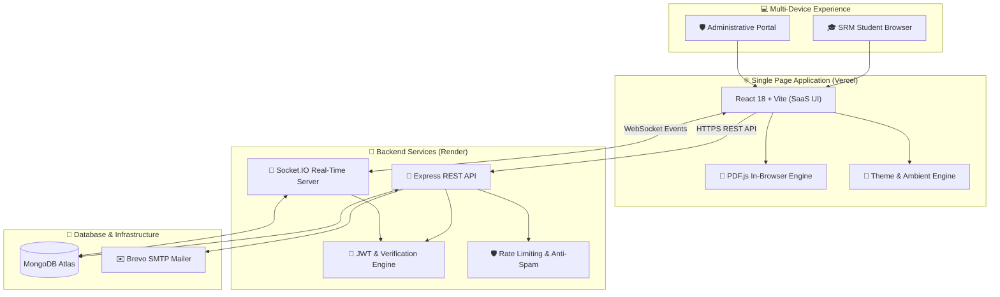

<div align="center">

# ⚡ SRM NOTE FINDER

### 🎓 Your Semester. Your Resources. One Smart Platform.

**Public showcase for SRM Note Finder — an academic resource library, precision GPA tools, attendance planner, and real-time community hub built for students at SRM Institute of Science and Technology.**

<br />

<p align="center">
  <a href="https://srmnotefinder.vercel.app" target="_blank">
    
  </a>
  
  
  
  
  
  
</p>

<br />

[](https://srmnotefinder.vercel.app)

<br />

**📚 150+ Academic Resources** • **🧮 SGPA & CGPA Engine** • **📊 75% Attendance Planner** • **💬 Student Community Lounge** • **🎨 Theme Studio**

---

</div>

## 🌌 Origin & Mission

During university exam seasons, study materials across engineering departments often end up fragmented—buried inside disorganized Google Drive links, expiring WhatsApp group chats, and unindexed cloud folders.

**SRM Note Finder** was created to solve this challenge once and for all:
- **Zero Login Friction for Notes:** Notes, question papers, and syllabus copies are accessible immediately without forcing a sign-up wall.
- **Embedded Document Streaming:** High-performance in-browser study viewer powered by **PDF.js** and Google Slides bypass streaming.
- **Smart Academic Math Tools:** Fast, accurate SGPA, CGPA, and 75% attendance calculations tuned precisely to SRM University academic regulations.

> 🎯 **Platform URL:** [https://srmnotefinder.vercel.app](https://srmnotefinder.vercel.app)

---

## 🌟 Core Pillars & Feature Breakdown

### 1. 📚 Centralized Academic Hub
- **150+ Curated Materials:** Comprehensive coverage across **Semesters 1 through 8** for B.Tech CSE and allied branches.
- **Unit-Wise Breakdown:** Instant filtering for Unit 1, 2, 3, 4, 5 lecture notes, lab manuals, and previous-year question papers (PYQs).
- **Direct Link Sharing:** Generate instant deep-links to specific subjects or individual units with one-click clipboard copying and WhatsApp sharing.

### 2. 🧮 SRM 10-Point SGPA & CGPA Calculators
- **Standard SRM Credit Matrix:** Pre-calibrated to the official letter-grade mapping (`O: 10`, `A+: 9`, `A: 8`, `B+: 7`, `B: 6`, `C: 5`, `W/RA: 0`).
- **Interactive Semester Worksheet:** Add custom subjects, adjust credits dynamically, and visualize credit-weighted averages instantly.
- **Cumulative CGPA Forecaster:** Track multi-semester performance with automated degree honors classification.

### 3. 📊 Smart Attendance & Safe Bunk Predictor
- **Mandatory 75% Threshold Defense:** Real-time percentage tracking with color-coded safety badges.
- **Predictive Bunk Mathematics:** Calculates precisely how many future lectures can be safely skipped without dropping below 75%, or how many consecutive classes are needed to recover from a shortage.
- **Granular Lecture Counters:** Track theory courses, lab hours, and practicals independently.

### 4. 💬 Verified SRM Student Community Lounge
- **Dual-Transport Real-Time Engine:** Built on **Socket.IO** with seamless REST polling fallback for resilient communication across university Wi-Fi.
- **Collaborative Doubts & Sharing:** Tagged discussions (`💬 General`, `❓ Doubts`, `📝 Notes`, `💡 Tips`), quoted replies, and emoji reactions.
- **Flexible Security Controls:** Administrative toggle supporting open guest conversations or verified `@srmist.edu.in` student login.

### 5. 🎨 Cyber-Academic Live Appearance Customizer
- **4 Visual Themes:** Cyberpunk Dark, Nordic Midnight, Emerald Scholar, and Crimson Neon.
- **Ambient Canvas Visuals:** Interactive space backgrounds, glowing particle meshes, and minimal grid modes.
- **Local Persistence:** Personal aesthetics synchronize seamlessly to browser storage with zero latency.

---

## 🧭 System Architecture



---

## 🧰 Technology Stack

| Layer | Technology | Usage |
| :--- | :--- | :--- |
| **Frontend** | **React 18, Vite** | Single-page responsive architecture with sub-second HMR |
| **Document Reader** | **PDF.js** | Client-side Canvas rendering for PDFs and study slides |
| **Styling & Motion** | **Custom CSS Variables** | Cyber-academic neon styling, adaptive mobile bottom navigation |
| **Backend API** | **Node.js, Express** | Modular REST routes, validation, and analytics telemetry |
| **WebSockets** | **Socket.IO** | Real-time community discussion and presence broadcasting |
| **Database** | **MongoDB Atlas** | High-availability cloud document store with Mongoose ODM |
| **Authentication** | **JWT & Bcrypt** | Secure OTP-verified institutional sessions and password hashing |
| **Hosting** | **Vercel & Render** | Global Edge CDN for frontend and continuous containerized API |

---

## 📊 Key Platform Figures

```text
├── 150+ High-Yield Curated Study Materials
├── 37 Engineering Subjects Covered
├── 8 Semesters (Full B.Tech Scope)
├── 75% Attendance Threshold Predictor Math
├── Dual-Transport (WebSocket + REST Polling Fallback)
└── 0-Second Delay In-Browser Study Viewer
```

---

## 📂 Repository Contents

```text
srm-note-finder-showcase/
├── assets/
│   └── showcase-banner.png    # High-resolution platform preview banner
└── README.md                  # Comprehensive product showcase & specifications
```

---

## 👤 Author & Creator

**S.S. Manikanda Prabu**  
*3rd-Year B.Tech Computer Science & Engineering · SRM Institute of Science and Technology*

- 🌐 **Live Platform:** [https://srmnotefinder.vercel.app](https://srmnotefinder.vercel.app)
- 🚀 **Interactive 3D Portfolio:** [ssmanikandaprabu.github.io/portfolio-3d](https://ssmanikandaprabu.github.io/portfolio-3d/)
- 💼 **LinkedIn:** [S.S. Manikanda Prabu](https://www.linkedin.com/in/s-s-manikanda-prabu-40070b325/)
- 🐙 **GitHub Profile:** [@SSManikandaprabu](https://github.com/SSManikandaprabu)
- 📧 **Contact:** [ssmanikandaprabu@gmail.com](mailto:ssmanikandaprabu@gmail.com)

---

<div align="center">
  <sub>SRM Note Finder is an independent student initiative built for the academic community at SRMIST.</sub>
</div>
